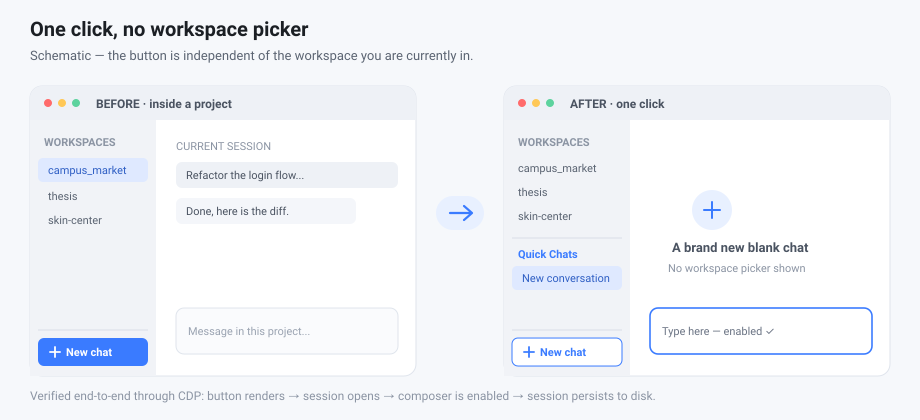

# dsh-one-click-new-session

> **One click → a blank, ready-to-type chat in DeepSeek Harness. No workspace picker, no context switching.**
> [中文文档](README.zh-CN.md)

[](LICENSE)
[](https://www.npmjs.com/package/dsh-one-click-new-session)
[](https://github.com/prog656/dsh-one-click-new-session/releases)
[](https://github.com/deepseek-ai/deepseek-harness)
[](https://awesome-dsh-plugin.com/p/prog656/dsh-one-click-new-session/)
[](CONTRIBUTING.md)



---

## Quick start

1. Download the latest zip from [Releases](https://github.com/prog656/dsh-one-click-new-session/releases/latest).
2. Unzip it, then **double-click `install.bat`** (Windows) or run `node install.mjs`.
3. Fully quit DSH and reopen it — a "New chat" button appears at the bottom of the sidebar.

> Needs Node.js 18+. No Node yet? Install the LTS build from [nodejs.org](https://nodejs.org) first, then repeat step 2.

> Listed in the [awesome-dsh-plugin](https://awesome-dsh-plugin.com/p/prog656/dsh-one-click-new-session/) community catalog under **UI Enhancements**.

---

## The problem

In the DSH desktop UI, **"New session" is tied to the currently selected workspace**. If you are inside a project and just want to ask a quick question, you either pollute that project with a throwaway session, or go build/select a folder first.

Worse: a blank session with **no workspace at all is inert**. The conversation view disables the composer via

```js
const inert = sessionId === undefined || (hero && chipTitle === undefined);
```

A blank session (`hero === true`) without a workspace has no `chipTitle`, so the input is disabled and the placeholder becomes "select a workspace". Creating a workspace-free session through the API alone therefore produces a chat you can **look at but not use**.

This plugin fixes both halves: an entry point that is independent of the selected workspace, **and** a session that is actually typeable.

## What it does

- Registers a **New chat** button in the `sidebar.footer.action` slot — a *list* slot that is always appended and never stolen by another plugin. It renders regardless of which workspace is selected.
- On click, ensures a dedicated scratch workspace exists (`workspaces.create` is idempotent by path), then calls the official `uiWorkspace.openWorkspace()` path, which reuses an existing blank session. Clicking twice does **not** pile up empty chats.
- Falls back to `sessions.create({ workspaceId })` + `uiWorkspace.openSession()` if the official path throws.
- Failures are visible: the button turns red, says "New chat failed", and its tooltip carries the error. No silent failures.
- Uses host theme CSS variables only, so light/dark themes work.

## Install

> Requires Node.js 18+ (DSH already depends on Node). Windows / macOS / Linux.

**Option A — zip installer** (this is the path for the desktop app):

```sh
# download dsh-one-click-new-session-vX.Y.Z.zip from Releases, unzip it, then inside:
node install.mjs            # English UI
node install.mjs --lang zh  # Chinese UI
```

On Windows you can simply **double-click `install.bat`** (Chinese UI).

**Option B — plugin manager** (only if your setup ships the `dsh` CLI; the desktop app does not):

```sh
dsh plugin --profile desktop add dsh-one-click-new-session
```

Use `--profile web` instead of `desktop` when you run the Web UI.

```sh
node install.mjs            # English UI
node install.mjs --lang zh  # Chinese UI
```

On Windows you can simply **double-click `install.bat`** (Chinese UI).

The installer auto-detects your DSH profile, creates `~/dsh-blank-sessions`, writes the four plugin files into `node_modules/@local/dsh-one-click-new-session`, and registers the bundle in the profile's `package.json`.

```sh
node install.mjs --dry-run                  # preview, writes nothing
node install.mjs --profile /path/to/profile
node install.mjs --dir /path/to/scratch
node install.mjs --uninstall
```

**Option B — manual**: see [docs/INSTALL.md](docs/INSTALL.md#manual-installation).

Then **fully quit and restart DSH**. See [docs/INSTALL.md](docs/INSTALL.md) for troubleshooting.

## Usage

1. Expand the sidebar.
2. Click **New chat** at the bottom (next to Settings).
3. Type and send. That's it.

Every new chat lands in the same **Quick Chats** workspace; sessions themselves are fully independent (own history, title, context). Clicking again while the current chat is still blank reuses it.

## Configuration

The scratch folder defaults to `~/dsh-blank-sessions`. The host half resolves it at startup and writes it into the client bundle, so you never edit a path by hand; set the `DSH_BLANK_SESSION_DIR` environment variable to use a different folder.

`lib/client.js` still carries the UI strings, which `install.mjs --lang` localises:

| Setting | Meaning | Default |
| --- | --- | --- |
| `DSH_BLANK_SESSION_DIR` (env) | Folder used for workspace-free chats | `~/dsh-blank-sessions` |
| `SCRATCH_TITLE` | Workspace group name in the sidebar | `Quick Chats` / `临时对话` |
| `LABEL`, `HINT`, `FAIL_LABEL` | Button text | localised by `--lang` |

## How it works

The technical write-up — the `inert` root cause, why host-side inline-script injection fails, the slot registry, and the client service call chain — is in [docs/HOW-IT-WORKS.md](docs/HOW-IT-WORKS.md).

## Known limitations

- **A dedicated workspace still exists** (visible as "Quick Chats"). DSH's UI does not accept input for a blank session with no workspace, so this is a deliberate, invisible-to-the-user workaround. Chats share that one folder — files written in chat A are visible in chat B.
- **The button hides when the sidebar is collapsed**, because the host hides the whole footer action area in rail mode. Expand the sidebar to see it.
- Verified on the Windows desktop build. The web profile should work but has not been end-to-end tested — [please report](https://github.com/prog656/dsh-one-click-new-session/issues).

## Compatibility

| | |
| --- | --- |
| DSH | `>= 0.1.7-rc.1` (developed against `0.2.x`) |
| Runtime | Node.js 18+, browser renderer |
| Platforms | Windows (verified), macOS / Linux (installer is cross-platform) |

## Contributing

Issues and PRs are welcome — read [CONTRIBUTING.md](CONTRIBUTING.md) first. To report a security issue privately, see [SECURITY.md](SECURITY.md).

## License

[MIT](LICENSE) — do whatever you want, just keep the notice.

## Disclaimer

This is an **unofficial community plugin**. It is not affiliated with, endorsed by, or published by DeepSeek. "DeepSeek Harness" is a trademark of its respective owner. This repository contains only the four files written for this plugin — no DSH source code, no `app.asar` contents, no credentials.
