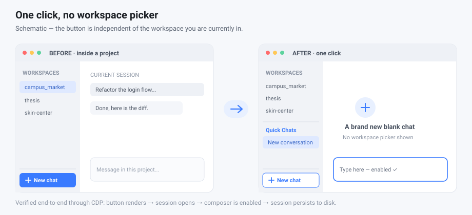

# DSH 一键新建对话

> **点一下 → 直接进入一个可输入的空白对话，不用选工作区，不用切来切去。**
> [English README](README.md)

[](LICENSE)
[](https://www.npmjs.com/package/dsh-one-click-new-session)
[](https://github.com/prog656/dsh-one-click-new-session/releases)
[](https://github.com/deepseek-ai/deepseek-harness)
[](CONTRIBUTING.md)



---

## 三步装上

1. 去 [Releases](https://github.com/prog656/dsh-one-click-new-session/releases/latest) 下载最新的 zip。
2. 解压，**双击 `install.bat`**（Windows），或运行 `node install.mjs`。
3. 完全退出 DSH 再打开，侧边栏底部会出现「新建对话」。

> 需要 Node.js 18+。没装的话先去 [nodejs.org](https://nodejs.org) 装 LTS 版，然后重复第 2 步。

---

## 解决什么问题

DSH 桌面端里，**「新会话」是绑定当前选中工作区的**。你正在项目里干活，只想随口问一句，要么把这条临时会话混进项目，要么先去建/选一个文件夹。

更麻烦的是：**完全没有工作区的空白会话根本不能打字**。对话视图里有这段判定：

```js
const inert = sessionId === undefined || (hero && chipTitle === undefined);
```

空白会话 `hero === true`，没有工作区就没有 `chipTitle`，于是 `inert = true`，输入框被禁用、占位文字变成「选择工作区」。只靠 API 建一个「无工作区会话」，结果是**能看不能聊**。

这个插件把两半都补齐了：入口与工作区选择解耦，**而且**开出来的会话真的能输入。

## 做了什么

- 在 `sidebar.footer.action` 插槽注册「新建对话」按钮。这是 **list 型插槽**，永远追加、不会被别的插件抢占，渲染与「当前选中哪个工作区」完全无关。
- 点击后：确保专用工作区存在（`workspaces.create` 按路径幂等）→ 走官方 `uiWorkspace.openWorkspace()`，内部复用已存在的空白会话，**连点两次不会堆空会话**。
- 官方路径抛错时回退到 `sessions.create({workspaceId})` + `uiWorkspace.openSession()`。
- 失败不静默：按钮变红、文案变「新建对话失败」、鼠标悬停显示具体原因。
- 样式只用宿主主题变量，明暗主题自适应。

## 安装

> 需要 Node.js 18+（DSH 本身依赖 Node）。Windows / macOS / Linux 均可。

**方式 A — 下载 zip 安装**（桌面版就走这条）：

```sh
# 从 Releases 下载 dsh-one-click-new-session-vX.Y.Z.zip，解压，然后在解压出的文件夹里：
node install.mjs            # 英文界面
node install.mjs --lang zh  # 中文界面
```

Windows 上直接**双击 `install.bat`** 即可（中文界面）。

**方式 B — 插件管理器**（只有自带 `dsh` 命令的环境才用；桌面版没有）：

```sh
dsh plugin --profile desktop add dsh-one-click-new-session
```

跑 Web 版界面的话，把 `desktop` 换成 `web`。

```sh
node install.mjs            # 英文界面
node install.mjs --lang zh  # 中文界面
```

Windows 用户直接**双击 `install.bat`** 即可（中文界面）。

安装脚本会自动探测 DSH profile、创建 `~/dsh-blank-sessions`、把四个插件文件写进 `node_modules/@local/dsh-one-click-new-session`、并在 profile 的 `package.json` 里注册 bundle。

```sh
node install.mjs --dry-run                  # 预演，不写任何文件
node install.mjs --profile /path/to/profile
node install.mjs --dir /path/to/scratch
node install.mjs --uninstall               # 卸载（保留会话数据）
```

**方式 B — 手动安装**：见 [docs/INSTALL.md](docs/INSTALL.md#手动安装)。

装完**完全退出并重启 DSH**。排障见 [docs/INSTALL.md](docs/INSTALL.md)。

## 怎么用

1. 展开左侧边栏。
2. 点底部（设置旁）的「新建对话」。
3. 直接打字发送，结束。

每次新对话都落在同一个「Quick Chats / 临时对话」分组下，但**会话彼此完全独立**（各自的历史、标题、上下文）。当前那条还没发过消息时再点一次，会复用它，不会多出空会话。

## 配置

免工作区对话的目录默认是 `~/dsh-blank-sessions`。**由 host 端在启动时解析并写进客户端产物**，你不需要手改任何路径；想换目录，设环境变量 `DSH_BLANK_SESSION_DIR` 即可。

`lib/client.js` 里剩下的只有界面文案，由 `install.mjs --lang` 本地化：

| 配置项 | 含义 | 默认值 |
| --- | --- | --- |
| `DSH_BLANK_SESSION_DIR`（环境变量） | 免工作区对话使用的目录 | `~/dsh-blank-sessions` |
| `SCRATCH_TITLE` | 侧边栏里显示的工作区组名 | `Quick Chats` / `临时对话` |
| `LABEL`、`HINT`、`FAIL_LABEL` | 按钮文案 | 由 `--lang` 决定 |

## 原理

`inert` 根因、为什么 host 端注入内联脚本走不通、插槽机制、客户端服务调用链，都写在 [docs/HOW-IT-WORKS.md](docs/HOW-IT-WORKS.md)。

## 已知限制

- **客观上都挂在同一个专用工作区上**。因为 DSH 官方 UI 不允许「无工作区 + 空白」的主视图接受输入，这是让用户无感的绕行方案。代价是几条对话共用目录：A 里建的文件，B 也看得见。
- **侧边栏收起成窄条时按钮会消失**——宿主把整个底部动作区 `display:none` 了，展开即可。
- Windows 桌面端已端到端实测；web profile 理论上可用但未实测，欢迎[反馈](https://github.com/prog656/dsh-one-click-new-session/issues)。

## 兼容性

| | |
| --- | --- |
| DSH | `>= 0.1.7-rc.1`（开发基于 `0.2.x`） |
| 运行时 | Node.js 18+ / 浏览器渲染端 |
| 平台 | Windows 已验证；macOS / Linux 安装脚本跨平台 |

## 参与贡献

欢迎提 issue 和 PR，先看 [CONTRIBUTING.md](CONTRIBUTING.md)。安全问题请按 [SECURITY.md](SECURITY.md) 私下反馈。

## 许可

[MIT](LICENSE)。

## 声明

这是**非官方社区插件**，与 DeepSeek 无隶属、背书或发布关系。本仓库只包含本插件自己写的四个文件，**不含 DSH 源码、`app.asar` 内容或任何凭据**。

---

📌 **第一次用 GitHub？** 从注册、建仓库、上传、发 Release 到让别人看见，完整步骤在 [docs/GITHUB-GUIDE.md](docs/GITHUB-GUIDE.md)；涨 star 的实操清单在 [docs/PROMOTION.md](docs/PROMOTION.md)。
