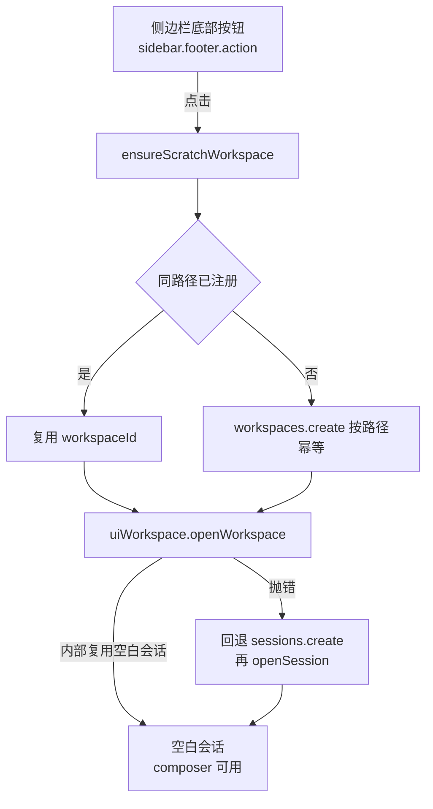

# 实现原理（源码级）

DSH 的设计是「一切皆插件」，运行时基于 Cordis；Web UI 的能力通过服务（`ctx.*`）与插槽（`ctx.slots`）暴露给插件。这个插件只用了官方公开机制，没有改宿主文件、没有注入内联脚本、没有自己拼 DOM。

## 两个源码级障碍

### 1. 官方 `startSession()` 强依赖工作区

`uiWorkspace` 的开会话路径在拿不到工作区时会直接 `clearMain()`。也就是说，「不传 workspace 也能开会话」在官方入口里本来就不成立。

### 2. 无工作区的空白会话**不能输入**

对话视图里有：

```js
const chipTitle = sessionWorkspace?.title
  ?? (workspaces.phase === "ready" || !cwd ? undefined : workspaceLabel(cwd));
const inert = sessionId === undefined || (hero && chipTitle === undefined);
```

- 空白会话 → `hero === true`
- 没有工作区 → `sessionWorkspace` 为空 → `chipTitle === undefined`
- ⇒ `inert === true` → **composer 被禁用、placeholder 变成「选择工作区」**

所以「用 API 建一个不带 workspaceId 的会话」看起来成功了，实际是个只读的对话。这也是为什么本插件**必须**配一个专用工作区：它不是偷懒，是绕开 `inert` 的唯一办法。用户视角依然是「不用选工作区」。

> 补充：后端 `SessionCommandController.create()` 里 `workspaceId` 与 `cwd` 互斥；都不传会落到 `defaultCwd = process.cwd()`（安装目录），在那里写文件会踩权限，不能当兜底。

## 为什么放弃旧方案

早期版本走 host 端 `webserver/index-inject` 注入内联脚本，链路是：内联脚本 → `window.__DSH_OPEN_SESSION__` 桥接 → DOM 轮询找按钮 → 触发点击。问题：

1. 内联脚本拿不到 **cordis 客户端 ctx**，无法调用 `uiWorkspace.openSession`；
2. 只能靠全局桥接 + DOM 轮询，UI 未就绪时**静默失败**；
3. 官方插件规范明确要求走插槽注册，不要手搓 DOM；
4. 即使跳转成功，开出来的会话也因 `inert` 不能输入。

## 现在的调用链



关键服务：

| 服务 | 用途 |
| --- | --- |
| `ctx.slots` | `inject` / `register` 到 `sidebar.footer.action` |
| `ctx.workspaces` | `list.getSnapshot()`、`create({path})`、`rename()` |
| `ctx.uiWorkspace` | `openWorkspace()`、`openSession()` |
| `ctx.sessions` | `create({workspaceId})` 回退路径 |

`inject: ["slots","sessions","workspaces","uiWorkspace"]` 保证四个服务都就绪后才 `apply()`，避免拿到 undefined。

## 为什么选 `sidebar.footer.action`

运行时插槽清单里，这个插槽是：

- **kind: list** —— 永远追加，多个插件共存，不会被后来的插件顶掉；
- **replaceRisk: none** —— 官方标注无抢占风险；
- **scope: global** —— 渲染与「当前选中哪个工作区」无关；
- 位置在侧边栏底部、设置旁。

其它候选都不合适：`sidebar.workspaces` 是 single 型会被抢占；`sidebar.panellist` 是面板语义；`shell.leading` 已被占用。代价是**侧边栏收起成窄条时宿主把整个底部动作区 `display:none`**，按钮会隐藏——这是宿主 CSS 决定的，没有干净的绕行方案，所以在 README 里如实写明。

## 失败可见性

按钮用 `busy` / `failed` 两个 state：`disabled` 防连点，失败时文案变「新建对话失败」、`data-failed=true` 触发红色样式、`title` 携带原始错误信息，并 `console.error`。配置没替换时也会明确抛错，不会静默。

## 端到端实测记录（开发机）

通过 CDP 驱动真实渲染端验证：

| 项 | 结果 |
| --- | --- |
| 客户端模块加载 | `client plugin ready` |
| 按钮渲染 | 1 个，252×36，侧边栏底部 |
| 点击 | 会话行 4 → 5 且高亮 |
| **composer** | `disabled = false`，输入后发送按钮可用 |
| 连点复用 | 第二次点击行数仍为 5 |
| 会话落盘 | scratch 对应目录出现新 session 文件夹 |

## 已知限制的技术原因

- **共用目录**：所有新会话落在同一个 workspace，A 里写的文件 B 也看得见。要做到「一个对话一个目录」得为每个会话动态建 workspace，侧边栏会多出大量分组，权衡后没做。
- **窄条模式隐藏**：见上。
- **web profile 未实测**：客户端逻辑与平台无关，但验证是在 Windows 桌面端完成的。
